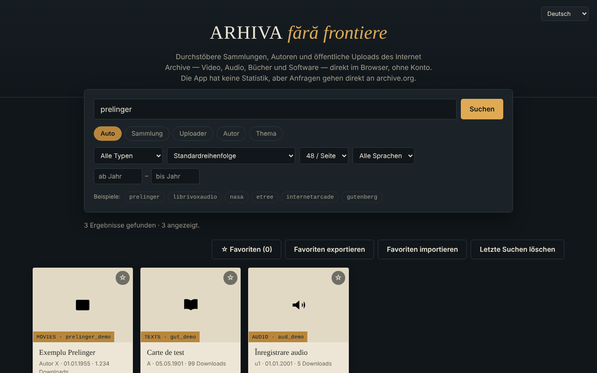

# Arhiva fără frontiere — Internet-Archive-Browser

[English](README.md) · [Română](README.ro.md) · [Français](README.fr.md) · [Italiano](README.it.md) · [Español](README.es.md) · [Português](README.pt.md) · **Deutsch** · [Magyar](README.hu.md)

**Version:** 1.2.3 · **Zuletzt aktualisiert:** 2026-10-22

Oberflächensprachen: **Română, English, Français, Italiano, Español, Português (PT), Deutsch, Magyar**

Eine einzige HTML-Datei zum Suchen und Durchstöbern von Sammlungen, Autoren und öffentlichen Uploads des Internet Archive (archive.org), in 8 Sprachen.

**Live:** https://chiuta.github.io/Arhiva-fara-frontiere/

*(Der Screenshot verwendet lokal simulierte Beispieldaten, keine echten Ergebnisse von archive.org.)*

## Was es ist

Ein inoffizieller Web-Client für die öffentliche API des Internet Archive: Du gibst eine Sammlung, einen Uploader, einen Autor oder ein Thema ein (oder fügst einen Link `archive.org/details/...` ein) und siehst die Ergebnisse als Karten, wo möglich mit Vorschau in der App. Er steht in keiner Verbindung zum Internet Archive. Er ist kein Werkzeug zur Suche in Webarchiven (Wayback Machine, Arquivo.pt usw.): Er fragt nur `advancedsearch.php` und `metadata` auf archive.org ab.

## Funktionen

Im Code überprüft:
- Suche nach Sammlung, Uploader, Autor, Thema oder „Auto“ (Sammlung OR Uploader OR Autor); das Präfix `@` und Links der Form `archive.org/details|metadata|download|embed/...` werden erkannt.
- Filter: Inhaltstyp (Video, Audio, Texte, Bilder, Software, etree, Daten, Webarchive, Sammlungen), Sortierung (auch zufällig), 24/48/96 Ergebnisse pro Seite, Sprache, Jahresbereich; „Mehr laden“ (Obergrenze ca. 10.000 Ergebnisse).
- Detailkarte: Beschreibung (in einfachen Text umgewandelt), Themen, übergeordnete Sammlungen, die ersten 25 Dateien mit Download-Link, Link „Auf archive.org öffnen“.
- Eingebettete Vorschau (iframe `archive.org/embed/...`) für Video, Audio, Texte, Software, etree; das größte Bild für den Typ „Bilder“.
- Favoriten, lokal im Browser gespeichert (localStorage, Schlüssel `arhiva-ff-favorite-v1`), mit JSON-Export/-Import.
- Die letzten 8 erfolgreichen Suchen werden im Suchfeld vorgeschlagen (lokal, im Browser; Schaltfläche „Letzte Suchen löschen“).
- Bei einem Netzwerkfehler erscheint ein Link „Dieselbe Suche auf archive.org versuchen →“ zur offiziellen Suche.
- Klare Meldung, wenn du offline bist (ohne unnötige Netzwerkanfrage); die Favoriten bleiben einsehbar.
- Kürzel: `/` setzt den Fokus in das Suchfeld.
- Oberfläche auf Rumänisch, Englisch, Französisch, Italienisch, Spanisch, Portugiesisch, Deutsch, Ungarisch (`?lang=xx` oder Browsersprache).
- Tastatur: fokussierbare Karten (Eingabe/Leertaste), Esc schließt das Fenster, Fokus bleibt im Fenster gefangen.

## Anleitung

1. Gib ins Suchfeld eine Sammlung (z. B. `prelinger`), einen `@uploader`, einen Autor ein oder füge einen archive.org-Link ein.
2. Wähle den Modus (Auto / Sammlung / Uploader / Autor / Thema) und optional die Filter.
3. Drücke „Suchen“; drücke „Mehr laden“ für die nächste Seite.
4. Drücke eine Karte für Details und Vorschau; Esc schließt das Fenster.
5. Markiere Favoriten mit ☆; „Favoriten exportieren“ speichert sie in einer JSON-Datei, „Favoriten importieren“ lädt sie wieder.

## Datenschutz und Netzwerk

- Der einzige kontaktierte externe Host: `archive.org` (und seine Subdomains über Weiterleitungen). Suchen, Metadaten, Vorschaubilder, Bilder, der eingebettete Player und Downloads sind direkte Anfragen an das Internet Archive: Es erhält deine IP-Adresse, deinen Browser, wonach du suchst und was du öffnest, und kann im Player Cookies setzen. Die App hat keinen eigenen Server, keine Analytik und kein Konto, aber „kein Tracking“ kann auf Seiten des Internet Archive nicht garantiert werden; siehe deren Datenschutzerklärung.
- Lokaler Speicher: die Favoritenliste (minimale Metadaten: Kennung, Titel, Typ, Autor, Datum; Schlüssel `arhiva-ff-favorite-v1`) und die letzten 8 Suchen (Schlüssel `arhiva-ff-recente-v1`) in `localStorage`, auf deinem Gerät; nichts wird irgendwohin gesendet. Du löschst sie, indem du die Favoriten leerst, mit der Schaltfläche „Letzte Suchen löschen“ oder über die Websitedaten. Ist der Speicher blockiert, bleiben die Favoriten nur im Arbeitsspeicher.
- Browserberechtigungen: fordert keine an.
- Sicherheit: Von archive.org empfangene Texte werden als Text (nicht als HTML) angezeigt; Beschreibungen werden mit `DOMParser` umgewandelt; die CSP-Richtlinie beschränkt das Netzwerk auf archive.org und erlaubt das Skript nur per Hash (ohne `unsafe-inline` für Skripte); der Vorschau-Frame hat `sandbox`. Der Import von Favoriten wird validiert.

## Grenzen und Warnhinweise

- Die Inhalte gehören dem Internet Archive und denjenigen, die sie hochgeladen haben; das Urheberrecht liegt bei den Rechteinhabern. Prüfe den rechtlichen Status jedes Materials, bevor du es weiterverwendest.
- Ist archive.org nicht erreichbar oder begrenzt es Anfragen, zeigt die App eine Fehlermeldung (Anfragen laufen nach 20 Sekunden ab).
- Die eingebettete Vorschau hängt vom Player des Internet Archive ab und kann vom Browser oder von Cookie-Einstellungen blockiert werden; sie wurde in diesem Repository nicht mit einem echten Netzwerk getestet.
- Die API-Obergrenze beschränkt die Suche auf etwa die ersten 10.000 Ergebnisse.

## Lokale Nutzung / offline

Lade `index.html` herunter und öffne sie in einem Browser. Ohne Internet funktioniert sie nicht (alle Daten kommen von archive.org).

## Lizenz

MIT — siehe Datei [LICENSE](LICENSE).

## Verlauf / Changelog

### 1.2.3 — 2026-10-22
- fff-kit 1.1.4: Touch-Ziele und Mindestschriftgröße

### 1.2.2 — 2026-10-22
- fff-kit 1.1.2: PBKDF2 mit 600.000 Iterationen, Schutz vor Clickjacking

### 1.2.1 — 2026-10-22
- Das 20-Sekunden-Zeitlimit (AbortError) wird jetzt abgefangen: übersetzte Meldung „keine rechtzeitige Antwort“ statt eines Konsolenfehlers.
- Suchanfragen werden normalisiert (Steuerzeichen entfernt, Leerzeichen zusammengefasst, max. 200 Zeichen); javascript:-/data:-/vbscript:-Schemata werden abgelehnt, bevor etwas an archive.org gesendet wird.
- Mobil: kein Text unter 12 px und Touch-Ziele von mindestens 24 px (WCAG 2.5.8).

### 1.1.0 — 2026-10-14
- Datensicherung und Datenkennzeichnung (fff-kit).

### 1.0.0 — 2026-10-12
- Version und Datum der letzten Aktualisierung werden in der App angezeigt (Fußzeile, in 7 Sprachen).

### 11. Oktober 2026 (Runde 7)
- Behoben: Der Fußzeilentext (7 Sprachen) besagte, die App speichere nichts im Browser, obwohl die Favoriten in `localStorage` gehalten werden.
- Neu: letzte Suchen mit Vorschlägen und Löschen; Link zur offiziellen archive.org-Suche, wenn die Anfrage fehlschlägt (in 7 Sprachen übersetzt).

### 11. Oktober 2026 (Runde 6)
- Neu: Favoriten werden in `localStorage` gehalten; eigene Meldung in 7 Sprachen, wenn du offline bist; Kürzel `/` für die Suche.
- Sicherheit: CSP mit hashbasiertem `script-src` (ohne `'unsafe-inline'` für Skripte).

### 11. Oktober 2026
- Behoben: Die Schaltfläche „Mehr laden“ erscheint nicht mehr im leeren Zustand (das Attribut hidden wurde durch CSS aufgehoben).
- Behoben: Die Felder „Jahr von / Jahr bis“ werden auf schmalen Bildschirmen nicht mehr abgeschnitten (Breite vergrößert, Umbruch in eine neue Zeile).
- Geprüft: 0 axe-core-Verstöße bei 1280 und 360 px, keine Konsolenfehler.

## Autor

Alexio — Alexandru-Ionuț Chiuță, Kontakt: alexio@trom.tf

## Zusammenfassung

Ein inoffizieller Einzeldatei-Browser für die öffentlichen Such- und Metadaten-APIs des Internet Archive (Oberfläche in 8 Sprachen): Suche nach Sammlung, Uploader, Urheber oder Thema, Filter, Vorschau der Objekte in einem eingebetteten Player, Export der Favoriten als JSON. Er kontaktiert nur archive.org (das deine IP und deine Anfragen sieht); er speichert lokal nur deine Favoritenliste (localStorage) und hat keine Analytik. Er ist kein Werkzeug zur Suche in Webarchiven (Wayback). Lizenz: MIT (siehe LICENSE).
