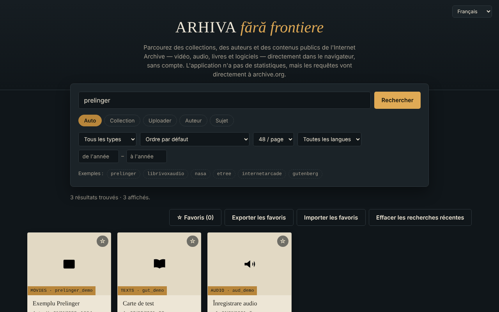

# Arhiva fără frontiere — navigateur Internet Archive

[English](README.md) · [Română](README.ro.md) · **Français** · [Italiano](README.it.md) · [Español](README.es.md) · [Português](README.pt.md) · [Deutsch](README.de.md) · [Magyar](README.hu.md)

**Version :** 1.2.5 · **Dernière mise à jour :** 2026-10-23

Langues de l'interface : **Română, English, Français, Italiano, Español, Português (PT), Deutsch, Magyar**

Un seul fichier HTML pour rechercher et parcourir des collections, des auteurs et des dépôts publics de l'Internet Archive (archive.org), en 8 langues.

**En ligne :** https://chiuta.github.io/Arhiva-fara-frontiere/

*(La capture utilise des données d'exemple simulées localement, et non de vrais résultats d'archive.org.)*

## De quoi s'agit-il

Un client web non officiel pour l'API publique de l'Internet Archive : vous saisissez une collection, un déposant, un auteur ou un sujet (ou collez un lien `archive.org/details/...`) et vous voyez les résultats sous forme de fiches, avec un aperçu dans l'application lorsque c'est possible. Il n'est pas affilié à l'Internet Archive. Ce n'est pas un outil de recherche dans les archives du web (Wayback Machine, Arquivo.pt, etc.) : il n'interroge que `advancedsearch.php` et `metadata` sur archive.org.

## Fonctionnalités

Vérifiées dans le code :
- Recherche par collection, déposant, auteur, sujet ou « Auto » (collection OU déposant OU auteur) ; le préfixe `@` et les liens `archive.org/details|metadata|download|embed/...` sont reconnus.
- Filtres : type de contenu (vidéo, audio, textes, images, logiciels, etree, données, archives web, collections), tri (y compris aléatoire), 24/48/96 résultats par page, langue, intervalle d'années ; « Charger plus » (plafond d'environ 10 000 résultats).
- Fiche détaillée : description (convertie en texte brut), sujets, collections parentes, les 25 premiers fichiers avec lien de téléchargement, lien « Ouvrir sur archive.org ».
- Aperçu intégré (iframe `archive.org/embed/...`) pour la vidéo, l'audio, les textes, les logiciels, etree ; l'image la plus grande pour le type « images ».
- Favoris enregistrés localement dans le navigateur (localStorage, clé `arhiva-ff-favorite-v1`), avec export/import JSON.
- Les 8 dernières recherches réussies sont suggérées dans le champ de recherche (localement, dans le navigateur ; bouton « Effacer les recherches récentes »).
- En cas d'erreur réseau, un lien « Essayer la même recherche sur archive.org → » vers la recherche officielle apparaît.
- Message clair lorsque vous êtes hors ligne (sans requête réseau inutile) ; les favoris restent consultables.
- Raccourci : `/` place le focus dans le champ de recherche.
- Interface en roumain, anglais, français, italien, espagnol, portugais, allemand, hongrois (`?lang=xx` ou langue du navigateur).
- Clavier : cartes focalisables (Entrée/Espace), Échap ferme la fenêtre, focus piégé dans la fenêtre.

## Mode d'emploi

1. Saisissez dans le champ de recherche une collection (p. ex. `prelinger`), un `@déposant`, un auteur, ou collez un lien archive.org.
2. Choisissez le mode (Auto / Collection / Déposant / Auteur / Sujet) et, éventuellement, les filtres.
3. Appuyez sur « Rechercher » ; appuyez sur « Charger plus » pour la page suivante.
4. Appuyez sur une fiche pour les détails et l'aperçu ; Échap ferme la fenêtre.
5. Marquez les favoris avec ☆ ; « Exporter les favoris » les enregistre dans un fichier JSON, « Importer les favoris » les recharge.

## Confidentialité et réseau

- Le seul hôte externe contacté : `archive.org` (et ses sous-domaines, via des redirections). Les recherches, les métadonnées, les vignettes, les images, le lecteur intégré et les téléchargements sont des requêtes directes vers l'Internet Archive : elle reçoit votre adresse IP, votre navigateur, ce que vous cherchez et ce que vous ouvrez, et peut déposer des cookies dans le lecteur. L'application n'a ni serveur propre, ni outil d'analyse, ni compte, mais l'absence de pistage ne peut pas être garantie du côté de l'Internet Archive ; consultez leur politique de confidentialité.
- Stockage local : la liste des favoris (métadonnées minimales : identifiant, titre, type, auteur, date ; clé `arhiva-ff-favorite-v1`) et les 8 dernières recherches (clé `arhiva-ff-recente-v1`) dans `localStorage`, sur votre appareil ; rien n'est envoyé ailleurs. Vous les supprimez en vidant les favoris, avec le bouton « Effacer les recherches récentes » ou depuis les données du site. Si le stockage est bloqué, les favoris restent uniquement en mémoire.
- Autorisations du navigateur : n'en demande aucune.
- Sécurité : les textes reçus d'archive.org sont affichés comme du texte (pas du HTML) ; les descriptions sont converties avec `DOMParser` ; la politique CSP limite le réseau à archive.org et n'autorise le script que par empreinte (sans `unsafe-inline` pour les scripts) ; le cadre d'aperçu a l'attribut `sandbox`. L'import des favoris est validé.

## Limites et avertissements

- Le contenu appartient à l'Internet Archive et à ceux qui l'ont déposé ; les droits d'auteur appartiennent aux ayants droit. Vérifiez le statut juridique de chaque document avant de le réutiliser.
- Si archive.org est indisponible ou limite les requêtes, l'application affiche un message d'erreur (les requêtes expirent au bout de 20 secondes).
- L'aperçu intégré dépend du lecteur de l'Internet Archive et peut être bloqué par le navigateur ou par les paramètres de cookies ; il n'a pas été testé dans ce dépôt avec un vrai réseau.
- Le plafond de l'API limite la recherche à environ les 10 000 premiers résultats.

## Utilisation locale / hors ligne

Téléchargez `index.html` et ouvrez-le dans un navigateur. Il ne fonctionne pas sans Internet (toutes les données viennent d'archive.org).

## Licence

MIT — voir le fichier [LICENSE](LICENSE).

## Historique / Changelog

### 1.2.3 — 2026-10-22
- fff-kit 1.1.4 : cibles tactiles et taille de texte minimale

### 1.2.2 — 2026-10-22
- fff-kit 1.1.2 : PBKDF2 600 000 itérations, protection anti-clickjacking

### 1.2.1 — 2026-10-22
- Le délai de 20 secondes (AbortError) est désormais intercepté : message traduit « pas de réponse à temps » au lieu d'une erreur en console.
- Les requêtes sont normalisées (caractères de contrôle supprimés, espaces réduits, 200 caractères max.) et les schémas javascript:/data:/vbscript: sont refusés avant tout envoi à archive.org.
- Mobile : aucun texte sous 12 px et cibles tactiles d'au moins 24 px (WCAG 2.5.8).

### 1.1.0 — 2026-10-14
- Sauvegarde et étiquetage des données (fff-kit).

### 1.0.0 — 2026-10-12
- La version et la date de la dernière mise à jour sont affichées dans l'application (pied de page, en 8 langues).

### 11 octobre 2026 (tour 7)
- Corrigé : le texte du pied de page (7 langues) indiquait que l'application n'enregistrait rien dans le navigateur, alors que les favoris sont conservés dans `localStorage`.
- Nouveau : recherches récentes avec suggestions et effacement ; lien vers la recherche officielle d'archive.org lorsque la requête échoue (traduits en 7 langues).

### 11 octobre 2026 (tour 6)
- Nouveau : les favoris sont conservés dans `localStorage` ; message dédié en 7 langues lorsque vous êtes hors ligne ; raccourci `/` pour la recherche.
- Sécurité : CSP avec `script-src` par empreinte (sans `'unsafe-inline'` pour les scripts).

### 11 octobre 2026
- Corrigé : le bouton « Charger plus » n'apparaît plus à l'état vide (l'attribut hidden était annulé par le CSS).
- Corrigé : les champs « année de / année à » ne sont plus tronqués sur un écran étroit (largeur augmentée, retour à la ligne).
- Vérifié : 0 violation axe-core à 1280 et 360 px, aucune erreur de console.

## Auteur

Alexio — Alexandru-Ionuț Chiuță, contact : alexio@trom.tf

## Résumé

Un navigateur non officiel, en un seul fichier, pour les API publiques de recherche et de métadonnées de l'Internet Archive (interface en 8 langues) : recherche par collection, déposant, créateur ou sujet, filtres, aperçu des documents dans un lecteur intégré, export des favoris en JSON. Il ne contacte qu'archive.org (qui voit votre IP et vos requêtes) ; il ne stocke localement que votre liste de favoris (localStorage) et n'a aucun outil d'analyse. Ce n'est pas un outil de recherche dans les archives du web (Wayback). Licence : MIT (voir LICENSE).
