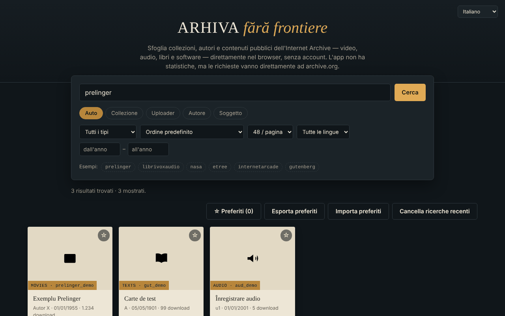

# Arhiva fără frontiere — browser per Internet Archive

[English](README.md) · [Română](README.ro.md) · [Français](README.fr.md) · **Italiano** · [Español](README.es.md) · [Português](README.pt.md) · [Deutsch](README.de.md) · [Magyar](README.hu.md)

**Versione:** 1.2.0 · **Ultimo aggiornamento:** 2026-10-19

Lingue dell'interfaccia: **Română, English, Français, Italiano, Español, Português (PT), Deutsch, Magyar**

Un unico file HTML per cercare e sfogliare collezioni, autori e caricamenti pubblici su Internet Archive (archive.org), in 8 lingue.

**Online:** https://chiuta.github.io/Arhiva-fara-frontiere/

*(La schermata usa dati di esempio simulati in locale, non risultati reali di archive.org.)*

## Che cos'è

Un client web non ufficiale per l'API pubblica di Internet Archive: scrivi una collezione, un uploader, un autore o un argomento (oppure incolli un link `archive.org/details/...`) e vedi i risultati come schede, con anteprima nell'app dove possibile. Non è affiliato a Internet Archive. Non è uno strumento di ricerca negli archivi web (Wayback Machine, Arquivo.pt ecc.): interroga soltanto `advancedsearch.php` e `metadata` di archive.org.

## Funzioni

Verificate nel codice:
- Ricerca per collezione, uploader, autore, argomento o «Auto» (collezione OR uploader OR autore); il prefisso `@` e i link `archive.org/details|metadata|download|embed/...` vengono riconosciuti.
- Filtri: tipo di contenuto (video, audio, testi, immagini, software, etree, dati, archivi web, collezioni), ordinamento (anche casuale), 24/48/96 risultati per pagina, lingua, intervallo di anni; «Carica altri» (limite di circa 10.000 risultati).
- Scheda di dettaglio: descrizione (convertita in testo semplice), argomenti, collezioni superiori, primi 25 file con link di download, link «Apri su archive.org».
- Anteprima incorporata (iframe `archive.org/embed/...`) per video, audio, testi, software, etree; l'immagine più grande per il tipo «immagini».
- Preferiti salvati in locale nel browser (localStorage, chiave `arhiva-ff-favorite-v1`), con esportazione/importazione JSON.
- Le ultime 8 ricerche riuscite sono suggerite nel campo di ricerca (in locale, nel browser; pulsante «Cancella ricerche recenti»).
- In caso di errore di rete compare un link «Prova la stessa ricerca su archive.org →» alla ricerca ufficiale.
- Messaggio chiaro quando sei offline (senza richieste di rete inutili); i preferiti restano consultabili.
- Scorciatoia: `/` sposta il focus nel campo di ricerca.
- Interfaccia in romeno, inglese, francese, italiano, spagnolo, portoghese, tedesco, ungherese (`?lang=xx` o lingua del browser).
- Tastiera: schede attivabili con il focus (Invio/Spazio), Esc chiude la finestra, focus intrappolato nella finestra.

## Guida all'uso

1. Scrivi nel campo di ricerca una collezione (ad es. `prelinger`), un `@uploader`, un autore oppure incolla un link archive.org.
2. Scegli la modalità (Auto / Collezione / Uploader / Autore / Argomento) e, facoltativamente, i filtri.
3. Premi «Cerca»; premi «Carica altri» per la pagina successiva.
4. Premi una scheda per dettagli e anteprima; Esc chiude la finestra.
5. Segna i preferiti con ☆; «Esporta preferiti» li salva in un file JSON, «Importa preferiti» li ricarica.

## Privacy e rete

- L'unico host esterno contattato: `archive.org` (e i suoi sottodomini, tramite reindirizzamenti). Ricerche, metadati, miniature, immagini, il player incorporato e i download sono richieste dirette a Internet Archive: riceve il tuo indirizzo IP, il browser, ciò che cerchi e ciò che apri, e può impostare cookie all'interno del player. L'app non ha un server proprio, statistiche né account, ma l'assenza di tracciamento non può essere garantita da parte di Internet Archive; vedi la loro informativa sulla privacy.
- Archiviazione locale: l'elenco dei preferiti (metadati minimi: identificativo, titolo, tipo, autore, data; chiave `arhiva-ff-favorite-v1`) e le ultime 8 ricerche (chiave `arhiva-ff-recente-v1`) in `localStorage`, sul tuo dispositivo; non vengono inviati da nessuna parte. Li elimini svuotando i preferiti, con il pulsante «Cancella ricerche recenti» o dai dati del sito. Se l'archiviazione è bloccata, i preferiti restano solo in memoria.
- Permessi del browser: non ne richiede alcuno.
- Sicurezza: i testi ricevuti da archive.org sono mostrati come testo (non HTML); le descrizioni sono convertite con `DOMParser`; la politica CSP limita la rete ad archive.org e consente lo script solo tramite hash (senza `unsafe-inline` per gli script); il frame di anteprima ha `sandbox`. L'importazione dei preferiti è validata.

## Limiti e avvertenze

- I contenuti appartengono a Internet Archive e a chi li ha caricati; il diritto d'autore spetta ai titolari. Verifica lo stato giuridico di ogni materiale prima di riutilizzarlo.
- Se archive.org non è disponibile o limita le richieste, l'app mostra un messaggio di errore (le richieste scadono dopo 20 secondi).
- L'anteprima incorporata dipende dal player di Internet Archive e può essere bloccata dal browser o dalle impostazioni dei cookie; non è stata testata in questo repository con una rete reale.
- Il limite dell'API restringe la ricerca ai primi 10.000 risultati circa.

## Uso locale / offline

Scarica `index.html` e aprilo in un browser. Non funziona senza Internet (tutti i dati provengono da archive.org).

## Licenza

MIT — vedi il file [LICENSE](LICENSE).

## Cronologia / Changelog

### 1.1.0 — 2026-10-14
- Copia di sicurezza ed etichettatura dei dati (fff-kit).

### 1.0.0 — 2026-10-12
- La versione e la data dell'ultimo aggiornamento sono mostrate nell'app (piè di pagina, in 7 lingue).

### 11 ottobre 2026 (round 7)
- Corretto: il testo del piè di pagina (7 lingue) diceva che l'app non salva nulla nel browser, mentre i preferiti sono conservati in `localStorage`.
- Nuovo: ricerche recenti con suggerimenti e cancellazione; link alla ricerca ufficiale di archive.org quando la richiesta fallisce (tradotti in 7 lingue).

### 11 ottobre 2026 (round 6)
- Nuovo: i preferiti sono conservati in `localStorage`; messaggio dedicato in 7 lingue quando sei offline; scorciatoia `/` per la ricerca.
- Sicurezza: CSP con `script-src` basato su hash (senza `'unsafe-inline'` per gli script).

### 11 ottobre 2026
- Corretto: il pulsante «Carica altri» non compare più nello stato vuoto (l'attributo hidden veniva annullato dal CSS).
- Corretto: i campi «anno da / anno a» non vengono più troncati sugli schermi stretti (larghezza aumentata, a capo su una nuova riga).
- Verificato: 0 violazioni axe-core a 1280 e 360 px, nessun errore in console.

## Autore

Alexio — Alexandru-Ionuț Chiuță, contatto: alexio@trom.tf

## Riepilogo

Un browser non ufficiale, in un unico file, per le API pubbliche di ricerca e metadati di Internet Archive (interfaccia in 8 lingue): ricerca per collezione, uploader, creatore o argomento, filtri, anteprima degli elementi in un player incorporato, esportazione dei preferiti in JSON. Contatta solo archive.org (che vede il tuo IP e le tue query); memorizza in locale soltanto l'elenco dei preferiti (localStorage) e non ha statistiche. Non è uno strumento di ricerca negli archivi web (Wayback). Licenza: MIT (vedi LICENSE).
