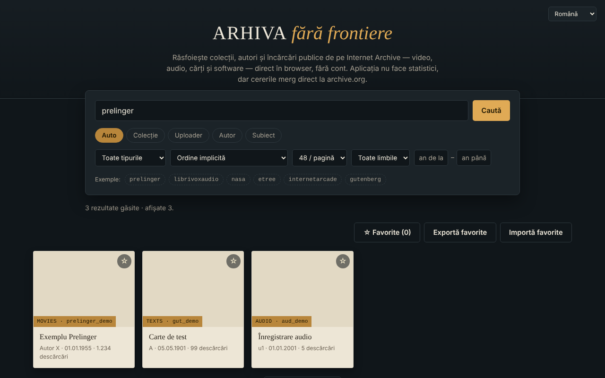

# Arhiva fără frontiere — răsfoitor Internet Archive

Un singur fișier HTML pentru a căuta și răsfoi colecții, autori și încărcări publice de pe Internet Archive (archive.org), în 7 limbi.

**Live:** https://chiuta.github.io/Arhiva-fara-frontiere/

**Ultima actualizare:** 11 octombrie 2026

*(Captura folosește date de exemplu simulate local, nu rezultate reale de pe archive.org.)*

## Ce este

Un client web neoficial pentru API-ul public al Internet Archive: scrii o colecție, un uploader, un autor sau un subiect (sau lipești un link `archive.org/details/...`) și vezi rezultatele ca fișe, cu previzualizare în aplicație unde este posibil. Nu este afiliat cu Internet Archive. Nu este un instrument de căutare în arhive web (Wayback Machine, Arquivo.pt etc.): interoghează doar `advancedsearch.php` și `metadata` de pe archive.org.

## Funcții

Verificate în cod:
- Căutare după colecție, uploader, autor, subiect sau „Auto" (colecție OR uploader OR autor); prefixul `@` și linkurile `archive.org/details|metadata|download|embed/...` sunt recunoscute.
- Filtre: tip de conținut (video, audio, texte, imagini, software, etree, date, arhive web, colecții), sortare (inclusiv aleatoriu), 24/48/96 rezultate pe pagină, limbă, interval de ani; „Încarcă mai multe" (plafon ~10 000 rezultate).
- Fișă detaliu: descriere (convertită în text simplu), subiecte, colecții părinte, primele 25 de fișiere cu link de descărcare, link „Deschide pe archive.org".
- Previzualizare în cadru (iframe `archive.org/embed/...`) pentru video, audio, texte, software, etree; imaginea cea mai mare pentru tipul „imagini".
- Favorite în memorie, cu export/import JSON.
- Interfață în română, engleză, franceză, italiană, spaniolă, portugheză, germană (`?lang=xx` sau limba browserului).
- Tastatură: carduri focalizabile (Enter/Spațiu), Esc închide fereastra, focus captiv în fereastră.

## Manual de utilizare

1. Scrie în câmpul de căutare o colecție (ex. `prelinger`), un `@uploader`, un autor sau lipește un link archive.org.
2. Alege modul (Auto / Colecție / Uploader / Autor / Subiect) și, opțional, filtrele.
3. Apasă „Caută"; apasă „Încarcă mai multe" pentru pagina următoare.
4. Apasă o fișă pentru detalii și previzualizare; Esc închide fereastra.
5. Marchează cu ☆ favoritele; „Exportă favorite" le salvează într-un fișier JSON, „Importă favorite" le reîncarcă.

## Confidențialitate și rețea

- Singura gazdă externă contactată: `archive.org` (și subdomeniile sale, prin redirecționări). Căutările, metadatele, miniaturile, imaginile, playerul din cadru și descărcările sunt cereri directe către Internet Archive: ei primesc adresa ta IP, browserul, ce cauți și ce deschizi, și pot seta cookie-uri în cadrul playerului. Aplicația nu are server propriu, analitice sau cont, dar „fără urmărire" nu poate fi garantat de partea Internet Archive; vezi politica lor de confidențialitate.
- Stocare locală: niciuna (nu folosește localStorage, sessionStorage sau IndexedDB). Favoritele se pierd la reîncărcarea paginii dacă nu le exporți.
- Permisiuni de browser: nu cere niciuna.
- Securitate: textele primite de la archive.org sunt afișate ca text (nu HTML); descrierile sunt convertite cu `DOMParser`; politica CSP limitează rețeaua la archive.org; cadrul de previzualizare are `sandbox`. Importul de favorite este validat.

## Limite și avertismente

- Conținutul aparține Internet Archive și celor care l-au încărcat; drepturile de autor sunt ale titularilor. Verifică statutul juridic al fiecărui material înainte de reutilizare.
- Dacă archive.org este indisponibil sau limitează cererile, aplicația arată un mesaj de eroare (cererile expiră după 20 de secunde).
- Previzualizarea în cadru depinde de playerul Internet Archive și poate fi blocată de browser sau de setările de cookie-uri; nu a fost testată în acest repository cu rețea reală.
- Plafonul API-ului limitează căutarea la aproximativ primele 10 000 de rezultate.

## Rulare locală / offline

Descarcă `index.html` și deschide-l în browser. Nu funcționează fără internet (toate datele vin de la archive.org).

## Licență

Licența nu este încă declarată.

## Istoric / Changelog

### 11 octombrie 2026
- Reparat: butonul „Încarcă mai multe” nu mai apare în starea goală (atributul hidden era anulat de CSS).
- Reparat: câmpurile „an de la / an până la” nu mai sunt trunchiate pe ecran îngust (lățime mărită, trecere pe rând nou).
- Verificat: 0 violări axe-core la 1280 și 360 px, fără erori de consolă.

## Autor

Alexio — Alexandru-Ionuț Chiuță, contact: alexio@trom.tf

## English summary

A single-file, unofficial browser for the Internet Archive's public search and metadata APIs (7 UI languages): search by collection, uploader, creator or subject, filter, preview items in an embedded player, export favorites as JSON. It contacts only archive.org (which sees your IP and queries); it stores nothing in the browser and has no analytics. It is not a web-archive (Wayback) search tool. License not yet declared.
