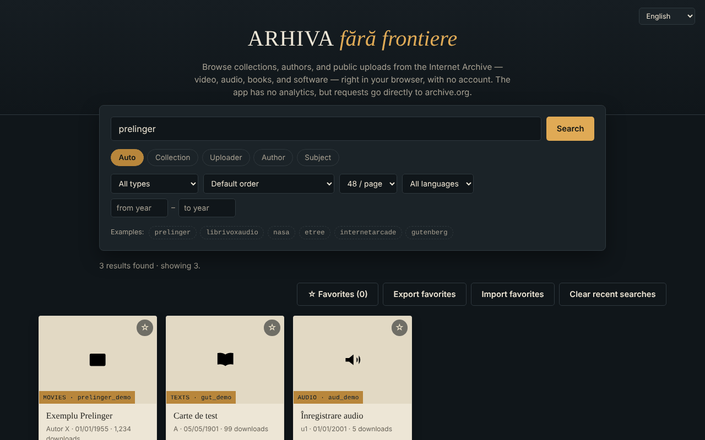

# Arhiva fără frontiere — Internet Archive browser

**English** · [Română](README.ro.md) · [Français](README.fr.md) · [Italiano](README.it.md) · [Español](README.es.md) · [Português](README.pt.md) · [Deutsch](README.de.md) · [Magyar](README.hu.md)

**Version:** 2.1.0 · **Last updated:** 2026-10-27

**Status:** stable · **Offline:** needs internet for any search or reading (the data comes from archive.org)

Interface languages: **Română, English, Français, Italiano, Español, Português (PT), Deutsch, Magyar**

A single HTML file for searching and browsing collections, authors and public uploads on the Internet Archive (archive.org), in 8 languages.

**Live:** https://chiuta.github.io/Arhiva-fara-frontiere/

*(The screenshot uses sample data simulated locally, not real results from archive.org.)*

## What it is

An unofficial web client for the Internet Archive's public API: you type a collection, an uploader, an author or a subject (or paste an `archive.org/details/...` link) and see the results as cards, with an in-app preview where possible. It is not affiliated with the Internet Archive. It is not a tool for searching web archives (Wayback Machine, Arquivo.pt, etc.): it only queries `advancedsearch.php` and `metadata` on archive.org. Since 2.1.0 there is one optional exception, clearly separate: a button that asks whether a *single web address* has a copy in the Wayback Machine (`archive.org/wayback/available`); it does not search inside web archives.

## Features

Verified in the code:
- Search by collection, uploader, author, subject or "Auto" (collection OR uploader OR author); the `@` prefix and `archive.org/details|metadata|download|embed/...` links are recognized.
- Filters: content type (video, audio, texts, images, software, etree, data, web archives, collections), sorting (including random), 24/48/96 results per page, language, year range; "Load more" (cap of ~10,000 results).
- Detail card: description (converted to plain text), subjects, parent collections, the first 25 files with a download link, an "Open on archive.org" link.
- Framed preview (iframe `archive.org/embed/...`) for video, audio, texts, software, etree; the largest image for the "images" type.
- **Full-text reader (2.0.0):** for books with an OCR text layer (`*_djvu.txt`), "Read the full text" loads the text from archive.org and shows it by section, with in-book search (case- and diacritic-insensitive, with snippets and highlighting), bookmarks and "where I left off" (automatic resume; "Reading (n)" list). Progress and bookmarks stay local (`arhiva-ff-lectura-v1`). Limit: texts up to 30 MB.
- Favorites saved locally in the browser (localStorage, key `arhiva-ff-favorite-v1`), with JSON export/import.
- The last 8 successful searches are suggested in the search box (locally, in the browser; "Clear recent searches" button).
- On a network error, a "Try the same search on archive.org →" link to the official search appears.
- A clear message when you are offline (no pointless network request); favorites remain available.
- Shortcut: `/` moves the focus to the search box.
- Interface in Romanian, English, French, Italian, Spanish, Portuguese, German, Hungarian (`?lang=xx` or the browser language).
- Keyboard: focusable cards (Enter/Space), Esc closes the window, focus is trapped in the window.
- **License filter (2.1.0):** choose public domain/CC0 or a CC variant (BY, BY-SA, BY-ND, BY-NC, BY-NC-SA, BY-NC-ND); the detail card shows the license declared by the uploader. It is the *declared* license, not a verification.
- **Wayback Machine, optional (2.1.0):** a separate box checks whether one web address has a copy in the Wayback Machine (one request to archive.org, only on button press) and links to the nearest copy or to the calendar. The app still does not search the content of web archives.
- **Favorites export (2.1.0):** besides JSON, CSV (formula-safe) and Markdown with links.

## User guide

1. Type a collection (e.g. `prelinger`), an `@uploader`, an author into the search box, or paste an archive.org link.
2. Choose the mode (Auto / Collection / Uploader / Author / Subject) and, optionally, the filters.
3. Press "Search"; press "Load more" for the next page.
4. Press a card for details and preview; Esc closes the window.
5. Mark favorites with ☆; "Export favorites" saves them to a JSON file, "Import favorites" reloads them.

## Privacy and network

- The only external host contacted: `archive.org` (and its subdomains, through redirects). Searches, metadata, thumbnails, images, the framed player and downloads are direct requests to the Internet Archive: they receive your IP address, your browser, what you search for and what you open, and may set cookies within the player. The app has no server of its own, no analytics and no account, but "no tracking" cannot be guaranteed on the Internet Archive's side; see their privacy policy.
- Local storage: the favorites list (minimal metadata: identifier, title, type, author, date; key `arhiva-ff-favorite-v1`) and the last 8 searches (key `arhiva-ff-recente-v1`) in `localStorage`, on your device; nothing is sent anywhere. You delete them by emptying the favorites, with the "Clear recent searches" button, or from the site data. If storage is blocked, favorites stay in memory only.
- Browser permissions: it requests none.
- Security: texts received from archive.org are displayed as text (not HTML); descriptions are converted with `DOMParser`; the CSP policy restricts the network to archive.org and allows the script only by hash (without `unsafe-inline` for scripts); the preview frame has `sandbox`. The favorites import is validated.

## Limits and warnings

- The content belongs to the Internet Archive and to those who uploaded it; copyright belongs to the rights holders. Check the legal status of each item before reusing it.
- If archive.org is unavailable or rate-limits requests, the app shows an error message (requests time out after 20 seconds).
- The framed preview depends on the Internet Archive player and may be blocked by the browser or by cookie settings; it has not been tested in this repository with a real network.
- The API cap limits the search to roughly the first 10,000 results.
- The license filter uses the `licenseurl` field **declared by the uploader** (not verified, and many items declare nothing); the query patterns follow the archive.org search guide but **have not been tested against the real archive.org in this repository**. The Wayback check relies on `archive.org/wayback/available`, whose browser (CORS) behaviour is also untested here; on failure the app offers the web.archive.org calendar link.

## Local / offline use

Download `index.html` and open it in a browser. It does not work without internet (all the data comes from archive.org).

## License

MIT — see the [LICENSE](LICENSE) file.

## History / Changelog

### 2.1.0 — 2026-10-27
- License filter (public domain/CC0 and six CC variants) and the declared license in the detail card.
- Optional Wayback Machine check for a single web address (separate box; the app still does not search web archives).
- Favorites export as CSV and Markdown (besides JSON).
- Not done: Wayback full-text/CDX search (beyond the stated scope); license/query patterns untested against the real archive.org.
- Already present: media-type filter ("Content type"). New test: `tests/v21.test.mjs`.

### 1.2.3 — 2026-10-22
- fff-kit 1.1.4: touch targets and minimum text size

### 1.2.2 — 2026-10-22
- fff-kit 1.1.2: PBKDF2 600,000 iterations, anti-clickjacking protection

### 1.2.1 — 2026-10-22
- The 20-second timeout (AbortError) is now caught: a translated "no response in time" message instead of an error in the console.
- Queries are normalised (control characters removed, spaces collapsed, 200-character limit) and javascript:/data:/vbscript: schemes are rejected before anything is sent to archive.org.
- Mobile: no text below 12 px and touch targets of at least 24 px (WCAG 2.5.8).

### 1.1.0 — 2026-10-14
- Backup and data labelling (fff-kit).

### 1.0.0 — 2026-10-12
- The version and the date of the last update are shown in the app (footer, in 7 languages).

### 11 October 2026 (round 7)
- Fixed: the footer text (7 languages) said the app does not save anything in the browser, although favorites are kept in `localStorage`.
- New: recent searches with suggestions and clearing; a link to the official archive.org search when the request fails (translated into 7 languages).

### 11 October 2026 (round 6)
- New: favorites are kept in `localStorage`; a dedicated message in 7 languages when you are offline; the `/` shortcut for search.
- Security: CSP with a hash-based `script-src` (without `'unsafe-inline'` for scripts).

### 11 October 2026
- Fixed: the "Load more" button no longer appears in the empty state (the hidden attribute was being overridden by CSS).
- Fixed: the "year from / year to" fields are no longer truncated on a narrow screen (width increased, wrapping onto a new line).
- Verified: 0 axe-core violations at 1280 and 360 px, no console errors.

## Author

Alexio — Alexandru-Ionuț Chiuță, contact: alexio@trom.tf

## Summary

A single-file, unofficial browser for the Internet Archive's public search and metadata APIs (8 UI languages): search by collection, uploader, creator or subject, filter, preview items in an embedded player, export favorites as JSON. It contacts only archive.org (which sees your IP and queries); it stores only your favorites list locally (localStorage) and has no analytics. It is not a web-archive (Wayback) search tool. License: MIT (see LICENSE).
