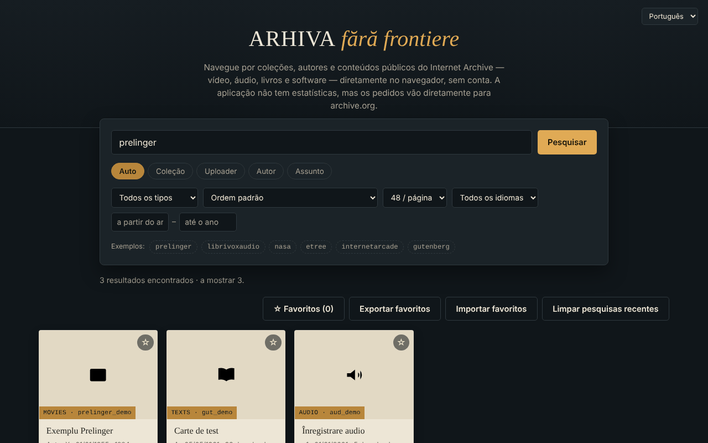

# Arhiva fără frontiere — explorador do Internet Archive

[English](README.md) · [Română](README.ro.md) · [Français](README.fr.md) · [Italiano](README.it.md) · [Español](README.es.md) · **Português** · [Deutsch](README.de.md) · [Magyar](README.hu.md)

**Versão:** 2.1.0 · **Última atualização:** 2026-10-27

**Estado:** estável · **Offline:** requer Internet para qualquer pesquisa ou leitura (os dados vêm do archive.org)

Idiomas da interface: **Română, English, Français, Italiano, Español, Português (PT), Deutsch, Magyar**

Um único ficheiro HTML para pesquisar e explorar coleções, autores e carregamentos públicos do Internet Archive (archive.org), em 8 idiomas.

**Online:** https://chiuta.github.io/Arhiva-fara-frontiere/

*(A captura usa dados de exemplo simulados localmente, não resultados reais do archive.org.)*

## O que é

Um cliente web não oficial para a API pública do Internet Archive: escreve uma coleção, um uploader, um autor ou um assunto (ou cola uma ligação `archive.org/details/...`) e vê os resultados como fichas, com pré-visualização na aplicação sempre que possível. Não é afiliado ao Internet Archive. Não é uma ferramenta de pesquisa em arquivos da web (Wayback Machine, Arquivo.pt, etc.): consulta apenas `advancedsearch.php` e `metadata` do archive.org.

## Funcionalidades

Verificadas no código:
- Pesquisa por coleção, uploader, autor, assunto ou «Auto» (coleção OR uploader OR autor); o prefixo `@` e as ligações `archive.org/details|metadata|download|embed/...` são reconhecidos.
- Filtros: tipo de conteúdo (vídeo, áudio, textos, imagens, software, etree, dados, arquivos da web, coleções), ordenação (incluindo aleatória), 24/48/96 resultados por página, idioma, intervalo de anos; «Carregar mais» (limite de cerca de 10 000 resultados).
- Ficha de detalhe: descrição (convertida em texto simples), assuntos, coleções superiores, os primeiros 25 ficheiros com ligação de transferência, ligação «Abrir no archive.org».
- Pré-visualização incorporada (iframe `archive.org/embed/...`) para vídeo, áudio, textos, software, etree; a maior imagem para o tipo «imagens».
- Favoritos guardados localmente no navegador (localStorage, chave `arhiva-ff-favorite-v1`), com exportação/importação JSON.
- As últimas 8 pesquisas bem-sucedidas são sugeridas no campo de pesquisa (localmente, no navegador; botão «Limpar pesquisas recentes»).
- Em caso de erro de rede, surge uma ligação «Tentar a mesma pesquisa no archive.org →» para a pesquisa oficial.
- Mensagem clara quando está offline (sem pedidos de rede inúteis); os favoritos continuam consultáveis.
- Atalho: `/` move o foco para o campo de pesquisa.
- Interface em romeno, inglês, francês, italiano, espanhol, português, alemão e húngaro (`?lang=xx` ou o idioma do navegador).
- Teclado: fichas com foco (Enter/Espaço), Esc fecha a janela, foco preso na janela.

## Manual de utilização

1. Escreva no campo de pesquisa uma coleção (p. ex., `prelinger`), um `@uploader`, um autor, ou cole uma ligação do archive.org.
2. Escolha o modo (Auto / Coleção / Uploader / Autor / Assunto) e, opcionalmente, os filtros.
3. Prima «Pesquisar»; prima «Carregar mais» para a página seguinte.
4. Prima uma ficha para ver os detalhes e a pré-visualização; Esc fecha a janela.
5. Marque os favoritos com ☆; «Exportar favoritos» guarda-os num ficheiro JSON, «Importar favoritos» volta a carregá-los.

## Privacidade e rede

- O único anfitrião externo contactado: `archive.org` (e os seus subdomínios, através de redirecionamentos). As pesquisas, os metadados, as miniaturas, as imagens, o leitor incorporado e as transferências são pedidos diretos ao Internet Archive: este recebe o seu endereço IP, o navegador, o que pesquisa e o que abre, e pode definir cookies dentro do leitor. A aplicação não tem servidor próprio, análise de utilização nem conta, mas a ausência de rastreamento não pode ser garantida da parte do Internet Archive; consulte a política de privacidade deles.
- Armazenamento local: a lista de favoritos (metadados mínimos: identificador, título, tipo, autor, data; chave `arhiva-ff-favorite-v1`) e as últimas 8 pesquisas (chave `arhiva-ff-recente-v1`) em `localStorage`, no seu dispositivo; nada é enviado para lado nenhum. Elimina-os esvaziando os favoritos, com o botão «Limpar pesquisas recentes» ou a partir dos dados do site. Se o armazenamento estiver bloqueado, os favoritos ficam apenas em memória.
- Permissões do navegador: não pede nenhuma.
- Segurança: os textos recebidos do archive.org são apresentados como texto (não HTML); as descrições são convertidas com `DOMParser`; a política CSP limita a rede ao archive.org e permite o script apenas por hash (sem `unsafe-inline` para scripts); a moldura de pré-visualização tem `sandbox`. A importação de favoritos é validada.

## Limites e avisos

- O conteúdo pertence ao Internet Archive e a quem o carregou; os direitos de autor pertencem aos titulares. Verifique o estatuto jurídico de cada material antes de o reutilizar.
- Se o archive.org estiver indisponível ou limitar os pedidos, a aplicação mostra uma mensagem de erro (os pedidos expiram após 20 segundos).
- A pré-visualização incorporada depende do leitor do Internet Archive e pode ser bloqueada pelo navegador ou pelas definições de cookies; não foi testada neste repositório com uma rede real.
- O limite da API restringe a pesquisa aos primeiros 10 000 resultados, aproximadamente.

## Utilização local / offline

Descarregue `index.html` e abra-o num navegador. Não funciona sem internet (todos os dados vêm do archive.org).

## Licença

MIT — consulte o ficheiro [LICENSE](LICENSE).

## Histórico / Changelog

### 1.2.3 — 2026-10-22
- fff-kit 1.1.4: alvos de toque e tamanho mínimo do texto

### 1.2.2 — 2026-10-22
- fff-kit 1.1.2: PBKDF2 600 000 iterações, proteção anti-clickjacking

### 1.2.1 — 2026-10-22
- O tempo limite de 20 segundos (AbortError) é agora tratado: mensagem traduzida «sem resposta a tempo» em vez de um erro na consola.
- As pesquisas são normalizadas (sem carateres de controlo, espaços comprimidos, máximo de 200 carateres) e os esquemas javascript:/data:/vbscript: são rejeitados antes de qualquer envio ao archive.org.
- Telemóvel: nenhum texto abaixo de 12 px e áreas táteis de pelo menos 24 px (WCAG 2.5.8).

### 1.1.0 — 2026-10-14
- Cópia de segurança e etiquetagem de dados (fff-kit).

### 1.0.0 — 2026-10-12
- A versão e a data da última atualização são apresentadas na aplicação (rodapé, em 7 idiomas).

### 11 de outubro de 2026 (ronda 7)
- Corrigido: o texto do rodapé (7 idiomas) dizia que a aplicação não guarda nada no navegador, embora os favoritos sejam mantidos em `localStorage`.
- Novo: pesquisas recentes com sugestões e eliminação; ligação para a pesquisa oficial do archive.org quando o pedido falha (traduzidos para 7 idiomas).

### 11 de outubro de 2026 (ronda 6)
- Novo: os favoritos são mantidos em `localStorage`; mensagem dedicada em 7 idiomas quando está offline; atalho `/` para a pesquisa.
- Segurança: CSP com `script-src` por hash (sem `'unsafe-inline'` para scripts).

### 11 de outubro de 2026
- Corrigido: o botão «Carregar mais» já não aparece no estado vazio (o atributo hidden era anulado pelo CSS).
- Corrigido: os campos «ano de / ano até» já não são truncados em ecrãs estreitos (largura aumentada, quebra para uma nova linha).
- Verificado: 0 violações axe-core a 1280 e 360 px, sem erros na consola.

## Autor

Alexio — Alexandru-Ionuț Chiuță, contacto: alexio@trom.tf

## Resumo

Um explorador não oficial, num único ficheiro, para as APIs públicas de pesquisa e metadados do Internet Archive (interface em 8 idiomas): pesquisa por coleção, uploader, criador ou assunto, filtros, pré-visualização dos itens num leitor incorporado, exportação dos favoritos em JSON. Contacta apenas o archive.org (que vê o seu IP e as suas consultas); guarda localmente apenas a lista de favoritos (localStorage) e não tem análise de utilização. Não é uma ferramenta de pesquisa em arquivos da web (Wayback). Licença: MIT (consulte LICENSE).
