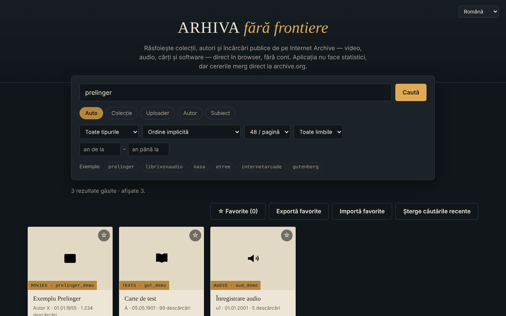

# Arhiva fără frontiere — răsfoitor Internet Archive

[English](README.md) · **Română** · [Français](README.fr.md) · [Italiano](README.it.md) · [Español](README.es.md) · [Português](README.pt.md) · [Deutsch](README.de.md) · [Magyar](README.hu.md)

**Versiune:** 1.2.2 · **Ultima actualizare:** 2026-10-22

Limbile interfeței: **Română, English, Français, Italiano, Español, Português (PT), Deutsch, Magyar**

Un singur fișier HTML pentru a căuta și răsfoi colecții, autori și încărcări publice de pe Internet Archive (archive.org), în 8 limbi.

**Live:** https://chiuta.github.io/Arhiva-fara-frontiere/

*(Captura folosește date de exemplu simulate local, nu rezultate reale de pe archive.org.)*

## Ce este

Un client web neoficial pentru API-ul public al Internet Archive: scrii o colecție, un uploader, un autor sau un subiect (sau lipești un link `archive.org/details/...`) și vezi rezultatele ca fișe, cu previzualizare în aplicație unde este posibil. Nu este afiliat cu Internet Archive. Nu este un instrument de căutare în arhive web (Wayback Machine, Arquivo.pt etc.): interoghează doar `advancedsearch.php` și `metadata` de pe archive.org.

## Funcții

Verificate în cod:
- Căutare după colecție, uploader, autor, subiect sau „Auto" (colecție OR uploader OR autor); prefixul `@` și linkurile `archive.org/details|metadata|download|embed/...` sunt recunoscute.
- Filtre: tip de conținut (video, audio, texte, imagini, software, etree, date, arhive web, colecții), sortare (inclusiv aleatoriu), 24/48/96 rezultate pe pagină, limbă, interval de ani; „Încarcă mai multe" (plafon ~10 000 rezultate).
- Fișă detaliu: descriere (convertită în text simplu), subiecte, colecții părinte, primele 25 de fișiere cu link de descărcare, link „Deschide pe archive.org".
- Previzualizare în cadru (iframe `archive.org/embed/...`) pentru video, audio, texte, software, etree; imaginea cea mai mare pentru tipul „imagini".
- Favorite salvate local în browser (localStorage, cheia `arhiva-ff-favorite-v1`), cu export/import JSON.
- Ultimele 8 căutări reușite sunt sugerate în câmpul de căutare (local, în browser; buton „Șterge căutările recente”).
- La eroare de rețea apare un link „Încearcă aceeași căutare pe archive.org →” către căutarea oficială.
- Mesaj clar când ești offline (fără cerere inutilă către rețea); favoritele rămân consultabile.
- Scurtătură: `/` mută focusul în câmpul de căutare.
- Interfață în română, engleză, franceză, italiană, spaniolă, portugheză, germană, maghiară (`?lang=xx` sau limba browserului).
- Tastatură: carduri focalizabile (Enter/Spațiu), Esc închide fereastra, focus captiv în fereastră.

## Manual de utilizare

1. Scrie în câmpul de căutare o colecție (ex. `prelinger`), un `@uploader`, un autor sau lipește un link archive.org.
2. Alege modul (Auto / Colecție / Uploader / Autor / Subiect) și, opțional, filtrele.
3. Apasă „Caută"; apasă „Încarcă mai multe" pentru pagina următoare.
4. Apasă o fișă pentru detalii și previzualizare; Esc închide fereastra.
5. Marchează cu ☆ favoritele; „Exportă favorite" le salvează într-un fișier JSON, „Importă favorite" le reîncarcă.

## Confidențialitate și rețea

- Singura gazdă externă contactată: `archive.org` (și subdomeniile sale, prin redirecționări). Căutările, metadatele, miniaturile, imaginile, playerul din cadru și descărcările sunt cereri directe către Internet Archive: ei primesc adresa ta IP, browserul, ce cauți și ce deschizi, și pot seta cookie-uri în cadrul playerului. Aplicația nu are server propriu, analitice sau cont, dar „fără urmărire" nu poate fi garantat de partea Internet Archive; vezi politica lor de confidențialitate.
- Stocare locală: lista de favorite (metadate minime: identificator, titlu, tip, autor, dată; cheia `arhiva-ff-favorite-v1`) și ultimele 8 căutări (cheia `arhiva-ff-recente-v1`) în `localStorage`, pe dispozitivul tău; nu se trimit nicăieri. Le ștergi golind favoritele, cu butonul „Șterge căutările recente” sau din datele site-ului. Dacă stocarea e blocată, favoritele rămân doar în memorie.
- Permisiuni de browser: nu cere niciuna.
- Securitate: textele primite de la archive.org sunt afișate ca text (nu HTML); descrierile sunt convertite cu `DOMParser`; politica CSP limitează rețeaua la archive.org și permite scriptul doar pe bază de hash (fără `unsafe-inline` pentru script); cadrul de previzualizare are `sandbox`. Importul de favorite este validat.

## Limite și avertismente

- Conținutul aparține Internet Archive și celor care l-au încărcat; drepturile de autor sunt ale titularilor. Verifică statutul juridic al fiecărui material înainte de reutilizare.
- Dacă archive.org este indisponibil sau limitează cererile, aplicația arată un mesaj de eroare (cererile expiră după 20 de secunde).
- Previzualizarea în cadru depinde de playerul Internet Archive și poate fi blocată de browser sau de setările de cookie-uri; nu a fost testată în acest repository cu rețea reală.
- Plafonul API-ului limitează căutarea la aproximativ primele 10 000 de rezultate.

## Rulare locală / offline

Descarcă `index.html` și deschide-l în browser. Nu funcționează fără internet (toate datele vin de la archive.org).

## Licență

MIT — vezi fișierul [LICENSE](LICENSE).

## Istoric / Changelog

### 1.2.2 — 2026-10-22
- fff-kit 1.1.2: PBKDF2 600 000 iterații, protecție anti-clickjacking

### 1.2.1 — 2026-10-22
- Timeout-ul de 20 de secunde (AbortError) este acum prins: mesaj tradus „nu a răspuns la timp”, nu eroare în consolă.
- Interogările sunt normalizate (fără caractere de control, spații comprimate, maximum 200 de caractere), iar schemele javascript:/data:/vbscript: sunt respinse înainte de a pleca spre archive.org.
- Mobil: niciun text sub 12 px și ținte tactile de cel puțin 24 px (WCAG 2.5.8).

### 1.1.0 — 2026-10-14
- Copie de rezervă și etichetare date (fff-kit).

### 1.0.0 — 2026-10-12
- Versiunea și data ultimei actualizări sunt afișate în aplicație (subsol, în 7 limbi).

### 11 octombrie 2026 (runda 7)
- Reparat: textul din subsol (7 limbi) spunea că aplicația nu salvează nimic în browser, deși favoritele sunt păstrate în `localStorage`.
- Nou: căutări recente cu sugestii și ștergere; link către căutarea oficială archive.org când cererea eșuează (traduse în 7 limbi).

### 11 octombrie 2026 (runda 6)
- Nou: favoritele se păstrează în `localStorage`; mesaj dedicat în 7 limbi când ești offline; scurtătura `/` pentru căutare.
- Securitate: CSP cu `script-src` pe hash (fără `'unsafe-inline'` pentru script).

### 11 octombrie 2026
- Reparat: butonul „Încarcă mai multe” nu mai apare în starea goală (atributul hidden era anulat de CSS).
- Reparat: câmpurile „an de la / an până la” nu mai sunt trunchiate pe ecran îngust (lățime mărită, trecere pe rând nou).
- Verificat: 0 violări axe-core la 1280 și 360 px, fără erori de consolă.

## Autor

Alexio — Alexandru-Ionuț Chiuță, contact: alexio@trom.tf

## Rezumat

Un navigator neoficial într-un singur fișier pentru API-urile publice de căutare și metadate ale Internet Archive (interfață în 8 limbi): căutare după colecție, încărcător, creator sau subiect, filtrare, previzualizarea elementelor într-un player încorporat, export al favoritelor ca JSON. Contactează doar archive.org (care vede adresa ta IP și interogările); stochează local doar lista de favorite (localStorage) și nu are analitice. Nu este un instrument de căutare în arhive web (Wayback). Licență: MIT (vezi LICENSE).
